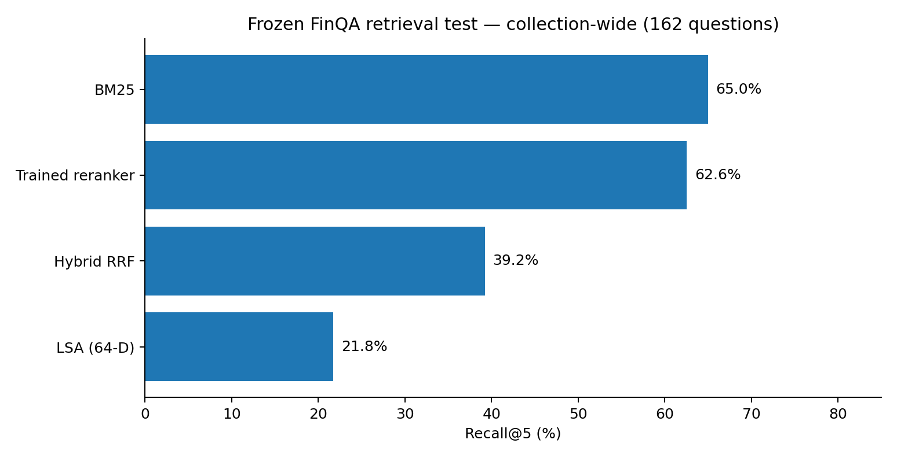
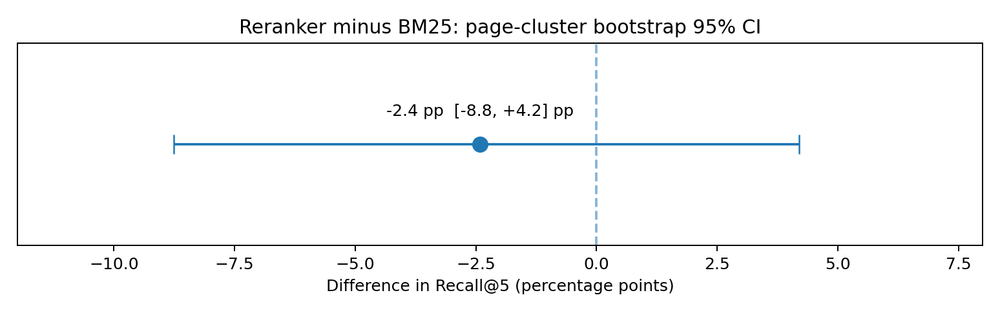
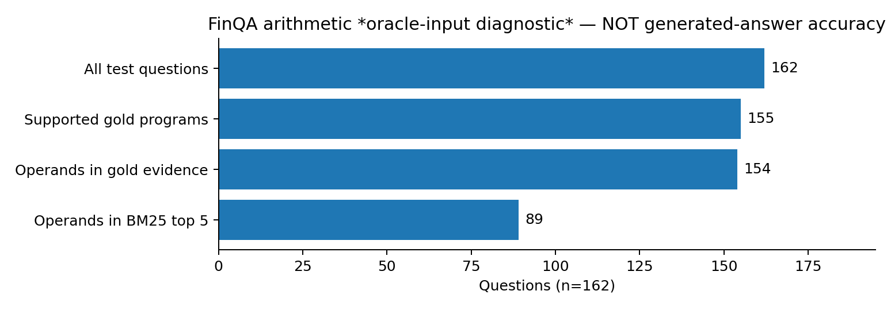
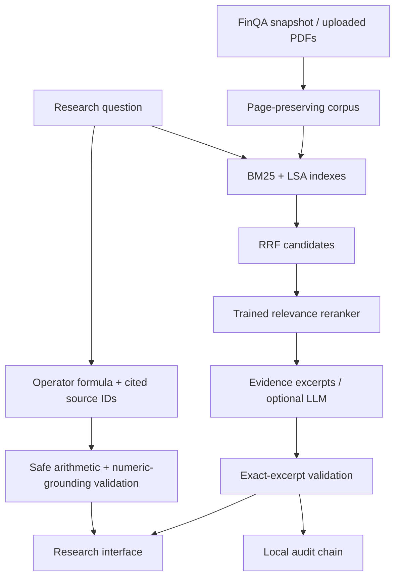

# Financial Document Research & Analysis

Search financial reports, inspect the source passages and analyse sentiment in a local Python application.

The project brings together document retrieval, a fine-tuned sentiment classifier and a FastAPI interface. Each search result links back to its source page, and the repository includes the experiments and error analysis behind the reported scores.

**Python · PyTorch · Hugging Face Transformers · LoRA · FastAPI · BM25**

[Results](#measured-results) · [Run locally](#run-locally-macos-linux-windows) · [Architecture](#architecture) · [Model card](docs/MODEL_CARD.md)

## At a glance

| Task | Result | Evaluation |
| :--- | :--- | :--- |
| Financial sentiment | **92.7% macro-F1** with DistilBERT + LoRA, vs. 83.8% for TF-IDF + logistic regression | 452 held-out Financial PhraseBank sentences; near-duplicate templates grouped before splitting |
| Report retrieval | **65.0% Recall@5** with BM25 across 8,778 indexed passages | 162 report-separated FinQA test questions |
| Research interface | PDF search, page-level citations, sentiment inference and request logs | Runs locally; setup below |

BM25 had the highest retrieval Recall@5 point estimate. The trained reranker's confidence interval overlaps it, so this test does not establish a reliable difference between the two methods. The sentiment result comes from a single training seed.

<details>
<summary><b>Evaluation details, uncertainty and audit figures</b></summary>

### What the evaluation actually establishes

- **Sentiment:** single-seed DistilBERT+LoRA achieved **92.74% macro-F1** vs. **83.80%** for the TF-IDF baseline on 452 near-duplicate-grouped test sentences (61 negative). The frozen-prediction, template-grouped bootstrap estimate for the *difference* is +8.9 points, with a 95% CI of **+4.7 to +13.5 points**. It excludes retraining variance and domain shift.
- **Retrieval:** on 162 report-separated FinQA test questions from 50 pages, BM25 achieved **64.97% Recall@5** collection-wide. Reranked retrieval achieved **62.55%**; its paired *page-cluster* bootstrap difference versus BM25 is **−2.4 percentage points**, 95% CI **[−8.8, +4.2]**. That interval crosses zero: **no clear winner between these two**. The seven-feature reranker is not a neural cross-encoder, and the vector baseline is LSA, not neural embeddings.
- **Numerical audit:** a safe bounded arithmetic interpreter handles **155/162** held-out FinQA gold programs. In collection-wide BM25 top-5 retrieval, all literal gold-program operands are visible in **89/162** cases. **This uses oracle programs supplied by FinQA and is not independent answer accuracy**; the limitation is the main research finding. See [numeric grounding report](reports/ARITHMETIC.md).
- **Security boundary:** prompt screening now passes the **13 known screening probes** (formerly 10); two forged-source tests are rejected. This is a small regression suite, *not* a claim of general attack resistance. Optional generated responses can output exact cited excerpts only; unsupported paraphrases are rejected.
- **Extractive answer audit:** the actual BM25→evidence-excerpt pipeline selected at least one gold passage for **119/162 (73.5%)** questions, with a question-weighted **page-cluster 95% CI of 65.0%–81.4%**. Retrieval found one in **126/162 (77.8%)**. This is **citation selection**, not numerical answer accuracy, not semantic faithfulness, and not evaluation of free-text LLM generation. See [extractive audit](reports/EXTRACTIVE_EVALUATION.md).







**All figures come from frozen measured artifacts.** Arithmetic uses benchmark-supplied oracle programs and is not an end-to-end answer score. `python scripts/make_figures.py` regenerates the images if matplotlib is installed.

See [statistical audit](reports/UNCERTAINTY.md), [extractive-answer audit](reports/EXTRACTIVE_EVALUATION.md), [numeric audit](reports/ARITHMETIC.md), [adversarial report](reports/REDTEAM.md), and [verification status](docs/VERIFICATION.md).

</details>

## Run locally (macOS, Linux, Windows)

> Run the server on your own computer, then open **http://127.0.0.1:8765/** there. The application is local; GitHub hosts the source code and recorded results.

### macOS quick start (Apple Silicon / Intel)

Open Terminal on your Mac, in the folder that contains this project's `README.md` and `run.py` (after cloning or extracting the ZIP):

```bash
cd ~/Downloads/financial-document-analysis  # change this if you cloned it elsewhere
pwd
ls README.md run.py
python3 --version
```

**Python 3.11–3.13 is required; Python 3.12 is the environment used for the original release.** If your `python3 --version` is outside that range, install Python 3.12 (e.g. `brew install python@3.12`) and substitute `python3.12` for `python3` in the next command.

```bash
python3 -m venv .venv
source .venv/bin/activate
python -m pip install --upgrade pip
python -m pip install -r requirements.lock.txt
python run.py
```

Installations download Python packages and may take a while on the first run. **Leave this Terminal window running.** Wait for the output that contains `Uvicorn running on http://127.0.0.1:8765` and `Application startup complete`, then open **`http://127.0.0.1:8765/` in a browser on that same Mac**. You should see the research dashboard. No API key is needed for local retrieval.

The report-data snapshot, trained reranker, trained sentiment adapters and measured results are included. Retrieval and lexical sentiment work offline after installation. Transformer sentiment downloads the pinned public DistilBERT base weights on first use (about 268 MB) and then runs offline.

### Other platforms

Run from the repository root, in a Python 3.11–3.13 environment:

```bash
python -m venv .venv
# Linux: source .venv/bin/activate
# Windows PowerShell: .venv\Scripts\Activate.ps1
python -m pip install -r requirements.lock.txt
python run.py
```

For a lighter dependency install using supported version ranges: `python -m pip install -e '.[test]'`.

### Troubleshooting: browser says “site can't be reached”

1. **Start the app first.** Opening `127.0.0.1:8765` from the GitHub README without running `python run.py` on your Mac cannot work. The Terminal running the server must remain open. The GitHub repository is source code, not a deployed web service.
2. **Confirm you're in the project, not Downloads itself:** `pwd` should end with `financial-document-analysis`, and `ls README.md run.py` should succeed. If you cloned the GitHub repo, use its actual folder instead.
3. **Look for startup errors.** If you see `ModuleNotFoundError` or `No module named uvicorn`, activate `.venv` and rerun `python -m pip install -r requirements.lock.txt`. If installation fails, resolve that error before opening the URL. If the index is initializing, wait for `Application startup complete`.
4. **Check the local server from a second Terminal tab:**

   ```bash
   curl -I http://127.0.0.1:8765/
   ```

   `HTTP/1.1 200 OK` means the web UI is responding; `Failed to connect` means no server is listening there. Do not use a remote browser, phone, or GitHub preview to test a service bound to your Mac's loopback address.
5. **Port already in use?** Run `lsof -nP -iTCP:8765 -sTCP:LISTEN` to inspect which process owns the port. Or launch this project on another port using `python scripts/serve.py --port 8766` and visit `http://127.0.0.1:8766/`.

To stop the server, press **Ctrl+C** in the Terminal window that launched it. To start it again later, run `cd ~/Downloads/financial-document-analysis && source .venv/bin/activate && python run.py` (adjust the folder if you cloned the repository).

**For reviewers:** this local-only dashboard is not deployed. Run the commands above to inspect the working interface, or use the committed figures, evaluations and source code without starting the app. Do not present `127.0.0.1` as a publicly accessible live demo.

## What works

- Search 8,778 report passages and table rows from 299 source pages across 224 report-years.
- Compare BM25, classical LSA vector search, hybrid reciprocal rank fusion and a supervised relevance reranker.
- Inspect exact evidence, original dataset page labels and source identifiers.
- Return exact cited evidence excerpts locally; optional generation is restricted to exact quotations, without independently verified narrative reasoning.
- Upload selectable-text PDFs, preserve physical page references and persist them across restarts.
- View measured benchmark results, source inventory and a local hash-chained audit trail.
- Verify operator-specified financial arithmetic using a bounded DSL with source-grounded numeric operands, cited quotes, an operation trace and an audit event.
- Inspect paired, document-clustered bootstrap intervals, the real extractive citation-selection audit, and an offline FinQA gold-program arithmetic audit.
- Export investigations, evaluation results and audit records as JSON.

## Measured results

A custom company/report-year-disjoint repartition of **883 FinQA development questions**: 475 training, 246 validation and 162 test. It is **not** an official FinQA leaderboard evaluation. The searchable corpus excludes questions, answers, gold evidence text and upstream model predictions.

| Test retrieval scope | BM25 Recall@5 | LSA Recall@5 | Hybrid Recall@5 | Trained reranker Recall@5 |
|---|---:|---:|---:|---:|
| Entire collection | 64.97% | 21.76% | 39.25% | 62.55% |
| Relevant source page supplied | 85.75% | 68.31% | 79.89% | 82.51% |

**The trained reranker improves the hybrid baseline but does not beat BM25's held-out recall point estimate. The paired 95% interval for reranker minus BM25 crosses zero, so the limited test does not establish a reliable winner.** In page scope it has higher MRR than BM25 (81.7% versus 79.8%). Keep both findings in any presentation. No hyperparameters were changed after inspecting test results.

The reranker was trained on **8,888 query–passage examples**, including 821 positives, using seven relevance features. This is actual supervised training of a small classifier; the retrieval embedding model and answer-generating LLM are not fine-tuned. A separate DistilBERT sentiment model is adapted using LoRA (see below). LSA vectors are corpus-fitted 64-dimensional TF-IDF/SVD representations.

Full results and predictions: [Evaluation](reports/EVALUATION.md), [machine-readable metrics](reports/evaluation.json), [per-query predictions](reports/predictions.json), [clustered uncertainty](reports/UNCERTAINTY.md).

A **validation-only feature ablation** independently refits six versions of the logistic reranker on identical training pairs, excluding LSA, numerical coverage, table indicator, bigrams or lexical coverage. Removing the table indicator lowered collection-wide validation Recall@5 from 53.8% to 48.0%; omitting bigram coverage also lowered collection-wide recall, even though it improved *page-scope* recall. This is exploratory post-hoc analysis, not a fresh test benchmark or grounds for changing the chosen model. [Full ablations](reports/ABLATION.md).

## Financial sentiment analysis

The Financial NLP workspace classifies positive, neutral and negative sentiment. It uses **distilbert/distilbert-base-uncased**, adapted with LoRA rank-8 attention adapters plus a trained classification head. The pretrained base weights stay frozen; 740,355 adapter/head parameters receive gradient updates.

Prepare the model before a demo with:

```bash
python scripts/setup_models.py
```

This downloads only the pinned public base model. The trained adapters are included in `data/sentiment-adapter/`. The full base weights are cached in `runtime/base-model/` and excluded from source distribution. The app can also prepare the base on first transformer inference; the UI explains the download.

Training uses Financial PhraseBank’s all-agreement subset: 2,264 original sentences, 2,259 after exact deduplication. Near-duplicate sentence templates (normalized character-ngram cosine >=0.85) are grouped before partitioning. There are **1,355 training, 452 validation and 452 test sentences**. Groups do not cross splits; this does not establish temporal or company-level separation.

A TF-IDF/logistic baseline and majority predictor are measured alongside the transformer. The checkpoint is selected by validation macro-F1. Temperature scaling is fitted on validation only; test labels are not used in training, checkpoint selection or calibration. **Held-out results (452 sentences): DistilBERT macro-F1 92.74%, accuracy 94.47%; TF-IDF macro-F1 83.80%, accuracy 87.61%.** Validation selected epoch 2 of 3. Temperature scaling reduced test ECE from 0.029 to 0.021 in this single run without changing predicted classes. These numbers do not establish trading performance or statistical superiority.

Classification and calibration results, per-class metrics, confusion matrices and per-sentence outputs are in `reports/sentiment-evaluation.json` and `reports/sentiment-predictions.json`.

A confidently wrong manual probe is retained in `reports/QUALITATIVE_CHECKS.md`; no model tuning followed it.

The Financial NLP view works on arbitrary pasted financial sentences and on retrieved passages via “Analyze this passage’s sentiment.” Report passages differ from the news-sentence training domain, so no equal-accuracy claim is made. Sentiment is not an investment recommendation or return prediction.

To reproduce the fixed training procedure: `python scripts/train_sentiment.py`. It performs three CPU-compatible epochs; this is a new training run and the already observed test set must not be used for tuning.

Financial PhraseBank is CC BY-NC-SA 3.0. Its license and README are retained under `data/PHRASEBANK_*`. Dataset and trained sentiment adapters are provided for noncommercial research; they are not relicensed under the source-code MIT license. DistilBERT’s base model is Apache-2.0, with its upstream revision recorded in `data/base_model_upstream.json`.

## Optional generated answers

Set `OPENAI_API_KEY` and `FINANCIAL_RESEARCH_MODEL` in the server process environment, choosing an API model that supports Chat Completions and strict JSON-schema output. Restart the server. The Generate checkbox becomes available; generation remains opt-in per query.

The implementation sends the question and up to five retrieved excerpts to `https://api.openai.com/v1/chat/completions`. Credentials never go to the browser. It validates returned source IDs and exact supporting quotes, handles refusal and malformed output, bounds output tokens and retries transient failures once.

**No paid model calls were made during this build or this revision.** Provider behavior is covered with mocked contract tests; live model compatibility, costs and answer quality remain unverified. Set credentials only on your computer; never commit them. A supported local evidence mode remains fully operational without them.

The model may now only return **exact excerpt text as the statement and the supporting quote**. It cannot author an unsupported paraphrase; the server rejects it. This narrows the faithfulness problem but cannot verify *relevance*, *selection*, or whether the evidence answers the original question. Evidence mode deliberately does not synthesize numerical answers.

### Verifiable arithmetic (separate from generation)

Use the **Verify a calculation** panel after a search, or POST to `/api/calculate` with a bounded formula and 1–8 cited passages. The server resolves citation IDs against its own indexed documents and requires every non-constant numeric literal to occur in the cited source quotations. Valid operations: `add`, `subtract`, `multiply`, `divide`, `exp`, `greater`; earlier results may be referenced as `#0`, `#1`. A detailed trace and audit ID are returned.

```json
{"program":"subtract(11503,10815)","evidence":[{"id":"<retrieved chunk id>","quote":"<exact excerpt with 11503 and 10815>"}]}
```

The formula is **supplied by a human**. The server does *not* infer the correct operation, identify the correct year/column or reconcile accounting units. It certifies arithmetic and literal occurrence, not the semantic truth of the financial answer. The frozen FinQA oracle audit exposes precisely why this distinction matters.

## Reproduce

```bash
python -m financial_research.evaluate
python scripts/redteam.py
python -m pytest -q
python scripts/evaluate_uncertainty.py
python scripts/evaluate_arithmetic.py
python scripts/ablate_reranker.py
python scripts/verify_manifest.py
```

The first command retrains the reranker and regenerates validation/test metrics. Treat existing test results as observed; further model tuning requires a new untouched evaluation set. Indexing uses no answer labels; unsupervised vocabulary/LSA fitting includes all searchable source documents, including held-out reports (a transductive retrieval setting).

The included dataset can be independently restored with `python scripts/download_data.py`; the downloader verifies the upstream Git blob hash and the canonical snapshot SHA-256 before replacing it. Provenance is recorded in `data/provenance.json`.

## Security and limits

This is a **single-user local research application**, not a deployed banking service. Bind it to loopback. It has no tool execution, trading, customer-account access, tenant isolation or production authentication. Do not put it on a public interface.

The 15-case adversarial suite includes direct/indirect injection, recommendation requests, forged citations and paraphrase/encoding probes. **All 13 known policy-screening regression cases currently pass, and both citation forgeries are rejected.** The original three bypasses are retained as regression cases. This limited test is **not** evidence of comprehensive prompt-injection resistance; novel encodings and paraphrases can still bypass pattern filters. No tool executor is present in extractive mode.

Uploaded PDFs are limited to 12 MiB and 400 pages, with a 6,000-chunk upload allowance. Scanned PDFs require external OCR. PDF parsing is not sandboxed. Heuristic answerability is not calibrated. Financial tables extracted from user PDFs are plain text, not structurally reconstructed.

Audit records omit raw questions and model output; a question hash is not strong anonymization. They retain document/source identifiers, timing, configuration and outcomes. The hash chain detects tampering against retained history but cannot prevent an owner rewriting or deleting the complete database. The bounded in-memory query cache holds up to 128 queries until restart.

Local data is in `runtime/` (ignored by Git). Stop the app before removing this directory to clear uploads and audit history. An empty runtime is created on the next launch.

## Architecture



Code guide: `corpus.py` parses sources; `retrieval.py` indexes and trains; `evaluate.py` measures results; `uncertainty.py` bootstraps frozen predictions; `scripts/ablate_reranker.py` runs validation-only feature ablations; `arithmetic.py` implements a safe DSL; `answer.py` handles restricted evidence/generation; `audit.py` records events; `app.py` serves the API and UI. The dependency-free browser UI lives in `static/`.

## Validation status

- The original build recorded **49 tests passing**, including checkpoint inference. The revised suite adds arithmetic, source-boundary and adversarial tests. See `docs/VERIFICATION.md` for what was executed in each environment.
- Browser checked: research query, source inspector, evaluation scope filters, source filtering, policy refusal, methodology and audit history on desktop Chromium.
- Not verified: live LLM, Docker runtime, remote CI, public hosting and operating systems not represented in this workspace. A cross-platform CI workflow is included but has not yet run on GitHub.

## Data and attribution

FinQA: Zhiyu Chen et al., *FinQA: A Dataset of Numerical Reasoning over Financial Data*, EMNLP 2021. [Paper](https://arxiv.org/abs/2109.00122) · [Repository](https://github.com/czyssrs/FinQA). The upstream MIT license is preserved at `data/FINQA_LICENSE`. Underlying report text originates from the respective issuers. Financial Document Research & Analysis is not affiliated with those issuers or FinQA.

Development included AI coding assistance. This is a single-user research application; evaluation scope and operational limits are documented above.

See [Independent reviewer guide](docs/REVIEWER_GUIDE.md), [GitHub publishing](docs/PUBLISHING.md), [Interview guide](docs/INTERVIEW_GUIDE.md), [CV wording](docs/CV.md), [Model card](docs/MODEL_CARD.md) and [verification](docs/VERIFICATION.md).
